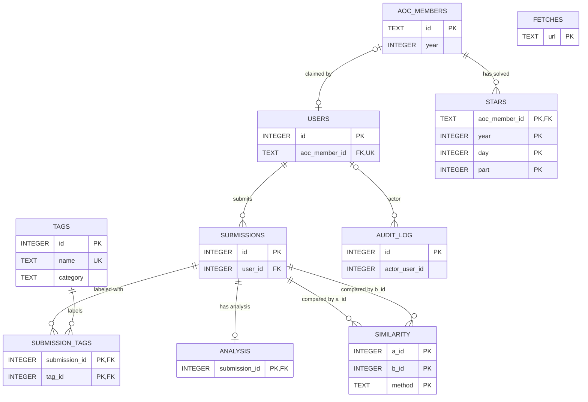

# Puzzle Scoreboard — Architecture & Delivery Plan

- **Status:** draft, active
- **Last updated:** 2026-11-12
- **Owner:** @ryanbthomas
- **Event target:** Advent of Code 2026 — opens 2026-12-01 00:00 EST (05:00 UTC), runs 12 days, closes 2026-12-12
- **Related:** `README.md` (local setup), `docs/RUNBOOK.md` (extracted from §15 when written)

This document is the single source of truth for architecture decisions. The GitHub
issues reference specific sections of it; if you change a decision here, update the
issues that depend on it.

---

## 1. What we're building

A private, invite-only web app for a group of fewer than 20 people participating in
Advent of Code. It does four things:

1. **Mirrors the AoC private leaderboard** — fetched server-side, cached, rendered with our own scoring on top.
2. **Links to each day's puzzle** — each year/day links to its official Advent of Code page, opening in a new tab; the app does not fetch, store, or reproduce puzzle statements.
3. **Accepts solution uploads** — files or pasted text, stored content-addressed, attributed to a claimed AoC identity.
4. **Compares submissions** — static analysis only: metrics, side-by-side diffs, similarity fingerprints. **Uploaded code is never executed.**

Everything is authenticated. There is no public read path.

---

## 2. Constraints that shaped the design

| Constraint | Consequence |
|---|---|
| AoC 2026 runs **12 days** (Dec 1–12), not 25 | Optimise for a two-week burst; batch and offline designs are viable |
| Private leaderboard JSON is **undocumented** and AoC asks for **≤1 poll / 15 min** | Exactly one server-side poller with a cache. No per-user fetch, no "refresh" button that hits AoC |
| AoC auth is a **session cookie** (~1 month lifetime) | Cookie is a long-lived credential: server-side only, never logged, expiry is an *expected* failure mode with an alarm |
| AoC asks users not to reproduce puzzle statements | Link to the official AoC page; never fetch, cache, embed, or redistribute puzzle text |
| **No code execution** | Removes sandboxing entirely — no containers, no resource limits, no escape risk. Analysis is pure text processing |
| **< 20 users**, invite-only | No horizontal scaling, no queue infrastructure, no Kubernetes. One small VPS, two processes |
| One developer, **fragmented time** over ~3 weeks | Environment must be one command after a 3-week gap; deploy path decided in week 1 and not revisited |
| Development is on **Linux**; VPS is Linux | No Docker Desktop / VM / file-sharing caveats. SQLite bind mounts are natively correct |

---

## 3. Architecture

Modular monolith, two long-running processes from one codebase.

```
              ┌──────────── VPS (1 vCPU / 2 GB, ~$5/mo) ─────────────┐
 Internet ───►│ Caddy (auto-TLS, gzip, security headers, rate limit)   │
    :443      │   │                                                     │
              │   ├─► web     :127.0.0.1:8000  (uvicorn, 2 workers)    │
              │   │     ├─ GitHub OAuth + allowlist                     │
              │   │     ├─ leaderboard / puzzle links / upload / diff views │
              │   │     └─ reads+writes SQLite (WAL)                    │
              │   │                                                     │
              │   └─► worker  (python -m app.worker)                    │
              │         ├─ APScheduler: AoC poller (≤1 req / 15 min)    │
              │         ├─ analysis jobs (parse, metrics, similarity)   │
              │         └─ writes derived rows back to SQLite           │
              │                                                         │
              │  /srv/aocboard/data/board.db   (+ -wal, -shm)           │
              │  /srv/aocboard/data/uploads/<sha256>.<ext>              │
              └─────────────────────────────────────────────────────────┘
```

**Why two processes:** a similarity pass over hundreds of files must not compete with
request handling at 05:00 UTC on Dec 1, and a crashed job must not take the web tier
down. Both share one SQLite file in WAL mode; no Redis, no broker.

**Why not a container:** the only thing that would justify one is code execution, which
is out of scope. See D15.

---

## 4. Decision log

| # | Decision | Choice | Rationale | Reversible? |
|---|---|---|---|---|
| D1 | Runtime shape | Modular monolith, two processes (`web`, `worker`) from one codebase | Job isolation without queue infra | Yes |
| D2 | Web framework | **FastAPI + Jinja2**, server-rendered; HTMX for partials only if needed | No build step, no SPA, usable on a phone at midnight | Yes |
| D3 | Database | **SQLite, WAL mode**, single file | One host, <20 users, low write volume; no daemon, no port; file-copy backups | Hard-ish — schema kept Postgres-portable |
| D4 | Scheduling | **APScheduler inside `worker`**; systemd timer as fallback | ~24 real jobs/year; Celery/RQ/Redis unwarranted | Yes |
| D5 | AoC access | **Single server-side poller, cache-first, ≤1 network request / 15 min** | AoC's stated limit; per-user refresh would violate it | **No — non-negotiable** |
| D6 | AoC auth | **Session cookie, server-side only**; test whether `view_key` works on the `.json` endpoint and prefer it if so (see Q1) | Cookie expires monthly; `view_key` would remove the credential class entirely | Yes |
| D7 | App auth | **GitHub OAuth** + explicit allowlist | Members already have GitHub; zero passwords stored; stable identity | Yes (magic-link fallback) |
| D8 | Puzzle access | Link each year/day to `https://adventofcode.com/{year}/day/{day}` in a new tab; do not fetch, store, or render puzzle statements | Respects the creator's request not to reproduce puzzle text | **No** |
| D9 | Scoring | **Compute our own** from star timestamps | Enables placement points, consistency, custom categories | Yes |
| D10 | Upload storage | **Content-addressed on disk** (`uploads/<sha256>.<ext>`) + metadata row | Dedupes identical submissions; small DB; trivial backup | Yes |
| D11 | Analysis | **Static only** — tree-sitter parse, metrics, normalized diff, winnowing similarity. **No execution** | Eliminates the hardest security problem | Yes (execution = separate project) |
| D12 | Dev environment | **Local venv via `uv`**; `uvicorn --reload` + worker in a second pane | Linux laptop; nothing resident after Ctrl-C; no daemon | Yes |
| D13 | Deploy | **systemd units on the VPS**; `git pull && uv sync --no-dev && systemctl restart` | No registry, no image tags, no build RAM cost; `LoadCredential` isolates the cookie | Yes (→ Docker + GHCR if ever needed) |
| D14 | Proxy / TLS | **Caddy** | Automatic certificates, ~10-line config | Yes |
| D15 | Containers | **Not used**, locally or in prod | Linux dev machine removes the Docker Desktop problems; no daemon to leave running; no parity gap that CI can't cover | Yes |

### 4.1 Consequences we accept

- **Pre-event leaderboard testing needs a fixture.** AoC leaderboard data is unavailable
  before Dec 1, so keep one anonymized leaderboard JSON fixture (Issue 6). Puzzle pages
  are external links and need no fixtures; HTTP error/session cases use mocked responses.
- **No artifact-level rollback.** Rollback is `git checkout <tag>`. OS library drift is a
  real if unlikely risk; mitigated by pinned Python via `uv` and CI running the suite in
  a clean container on every push.
- **Cookie expiry mid-event is expected.** Re-pasting is a 30-second admin action with an
  alarm (§15.4).
- **No execution means no runtime comparison.** "Fastest solution" cannot be a category;
  code-golf (bytes/LOC) and structural similarity are the substitutes.
- **Similarity is a review signal, never a verdict.** Present as "review this pair".

---

## 5. Non-goals

Executing submissions · public/anonymous access · mobile app · websockets / live push ·
multi-year support · teams or sub-boards · LLM/AI code review · chat or comments on
submissions · replaying AoC's global leaderboard (it no longer exists).

---

## 6. Data model

SQLite, WAL. All timestamps stored as UTC ISO-8601 text. `year` present on every
event-scoped table so a second year is additive rather than a migration.

```sql
PRAGMA journal_mode = WAL;
PRAGMA busy_timeout = 5000;
PRAGMA foreign_keys = ON;
PRAGMA synchronous = NORMAL;
```

### users
| Column | Type | Notes |
|---|---|---|
| id | INTEGER PK | |
| github_id | TEXT UNIQUE NOT NULL | stable identity key |
| github_login | TEXT NOT NULL | changes if user renames |
| display_name | TEXT | |
| aoc_member_id | TEXT NULL REFERENCES aoc_members(id) | **UNIQUE when non-null** — one member, one user |
| claim_status | TEXT | `none` / `pending` / `approved` |
| role | TEXT | `member` / `admin` |
| approved_at | TEXT NULL | null ⇒ not allowlisted |
| created_at | TEXT NOT NULL | |

### aoc_members
| Column | Type | Notes |
|---|---|---|
| id | TEXT PK | AoC member id — **never key on name** |
| year | INTEGER NOT NULL | |
| name | TEXT | members rename themselves |
| local_score | INTEGER | AoC's own score, kept for reference |
| stars | INTEGER | |
| last_seen_at | TEXT NOT NULL | |

Index: `(year)`

### stars
| Column | Type | Notes |
|---|---|---|
| aoc_member_id | TEXT NOT NULL REFERENCES aoc_members(id) | |
| year | INTEGER NOT NULL | |
| day | INTEGER NOT NULL | 1..12 |
| part | INTEGER NOT NULL | 1..2 |
| solved_at | TEXT NOT NULL | UTC; drives all our scoring |
| PRIMARY KEY | (aoc_member_id, year, day, part) | makes polling idempotent |

### submissions
| Column | Type | Notes |
|---|---|---|
| id | INTEGER PK | |
| user_id | INTEGER NOT NULL REFERENCES users(id) | |
| year | INTEGER NOT NULL | |
| day | INTEGER NOT NULL | |
| part | INTEGER | 1, 2, or null (whole day) |
| sha256 | TEXT NOT NULL | FK-by-value into blob store |
| language | TEXT NOT NULL | detected, not trusted from client |
| bytes | INTEGER NOT NULL | |
| original_filename | TEXT | display only, sanitised |
| created_at | TEXT NOT NULL | |

Index: `(year, day, language)`, `(user_id)`, `(sha256)`

### tags
| Column | Type | Notes |
|---|---|---|
| id | INTEGER PK | |
| name | TEXT UNIQUE NOT NULL | shared concept label, e.g. `Dijkstra's algorithm` |
| category | TEXT NOT NULL | e.g. `data_structure` / `algorithm` |

### submission_tags
| Column | Type | Notes |
|---|---|---|
| submission_id | INTEGER NOT NULL REFERENCES submissions(id) | |
| tag_id | INTEGER NOT NULL REFERENCES tags(id) | |
| PRIMARY KEY | (submission_id, tag_id) | prevents duplicate tags on a submission |

### analysis
| Column | Type | Notes |
|---|---|---|
| submission_id | INTEGER PK REFERENCES submissions(id) | |
| syntax_ok | INTEGER NULL | null ⇒ language unsupported |
| loc | INTEGER | |
| comment_ratio | REAL | |
| max_depth | INTEGER | AST nesting |
| complexity | INTEGER | rough cyclomatic |
| identifiers | INTEGER | |
| longest_line | INTEGER | |
| ast_histogram | TEXT | JSON: node type → count |
| analysed_at | TEXT NOT NULL | |
| analyser_version | TEXT NOT NULL | bump to force re-analysis |

### similarity
| Column | Type | Notes |
|---|---|---|
| a_id, b_id | INTEGER | `a_id < b_id` enforced |
| method | TEXT | `winnowing-v1` |
| score | REAL | 0..1 Jaccard |
| computed_at | TEXT NOT NULL | |
| PRIMARY KEY | (a_id, b_id, method) | |

Same-language pairs only.

### fetches
| Column | Type | Notes |
|---|---|---|
| url | TEXT PK | cache key |
| payload | BLOB | |
| etag | TEXT NULL | |
| last_modified | TEXT NULL | |
| fetched_at | TEXT NOT NULL | TTL anchor |

### audit_log
| Column | Type | Notes |
|---|---|---|
| id | INTEGER PK | |
| at | TEXT NOT NULL | |
| actor_user_id | INTEGER NULL | |
| action | TEXT NOT NULL | e.g. `aoc.session_expired`, `claim.approved` |
| target | TEXT NULL | |
| detail | TEXT NULL | never contains secrets |

### Entity relationship diagram



`SIMILARITY.a_id`/`b_id` and `AUDIT_LOG.actor_user_id` are shown as logical
references; §6 does not currently declare them as SQL foreign keys. `FETCHES`
has no relationships in this schema. Puzzle links are derived from year/day and
are not stored in the database.

**Migrations** are Alembic, up-only, applied on boot (`alembic upgrade head && exec …`)
or via a `Type=oneshot` unit ordered before `web` and `worker`. Never hand-edit the prod
schema (§15.3).

---

## 7. Interfaces and contracts

### 7.1 AoC fetch contract

One function owns the etiquette. Nothing else in the codebase may call AoC.

```
get_json(url, *, fixture_key=None) -> dict      # or raises SessionExpired / AoCError
```

- TTL: **900 s**, enforced by `fetches.fetched_at` **and** an in-process guard.
- Conditional requests: send `If-None-Match` / `If-Modified-Since` when cached; `304`
  refreshes `fetched_at` without re-storing.
- `User-Agent`: descriptive, with a contact address.
- Expired session detected by `302`/`401`/`403` **or** login-page markers in the body ⇒
  raise `SessionExpired`, write `audit_log` row, alert once. **Never retry in a loop.**
- `5xx` ⇒ exponential backoff, hard timeout 20 s, max 3 attempts, then alert.
- `AOC_FIXTURES=1` ⇒ serve the anonymized leaderboard JSON fixture instead of making a
  leaderboard request. HTTP error and expired-session tests use mocked responses, not
  saved AoC pages.

### 7.2 Worker entrypoints

| Command | Purpose |
|---|---|
| `python -m app.worker` | long-running: scheduler (poller + analysis drain), heartbeat |
| `python -m app.worker --once` | one poll cycle then exit (dev, smoke test) |
| `python -m app.worker --reanalyse` | re-run static analysis over all submissions |
| `python -m app.worker --recompute-similarity` | rebuild `similarity` for a year/day |

Scheduling: poll at **:02 and :17** past each hour from Dec 1 to Dec 12 inclusive;
once daily outside that window. Offsets avoid the 00:00 EST release stampede.

### 7.3 Configuration

All via environment; `.env` in dev, `/etc/aocboard/env` (mode 0600) in prod.
pydantic-settings; prod boot fails loudly if a required secret is missing.

| Key | Default | Notes |
|---|---|---|
| `APP_ENV` | `dev` | `dev` / `prod` |
| `DATABASE_URL` | `sqlite:///./data-dev/dev.db` | prod: `sqlite:////srv/aocboard/data/board.db` |
| `AOC_YEAR` | current | |
| `AOC_LEADERBOARD_ID` | — | from the private leaderboard URL |
| `AOC_SESSION` | — | **prod required**; env or `$CREDENTIALS_DIRECTORY/aoc_session`; never logged |
| `AOC_FIXTURES` | `0` | `1` uses the anonymized leaderboard JSON fixture |
| `AOC_VIEW_KEY` | unset | if Q1 resolves favourably, preferred over the cookie |
| `GITHUB_CLIENT_ID` / `GITHUB_CLIENT_SECRET` | — | OAuth app |
| `SESSION_SECRET` | — | signs session cookies |
| `ADMIN_GITHUB_LOGIN` | — | bootstrap admin |
| `ALLOWLIST` | empty | comma-separated logins, or leave empty and approve via UI |
| `UPLOAD_MAX_BYTES` | `1048576` | |

### 7.4 Make targets

`make dev` (uvicorn --reload) · `make worker` · `make test` (pytest -q) · `make deploy`
(pull + sync + restart over ssh) · `make logs` (journalctl -u) · `make backup` ·
`make reset-db` · `make lint`

### 7.5 Storage layout

```
/srv/aocboard/
  app/  migrations/  pyproject.toml  uv.lock      # code, from git
  data/
    board.db  board.db-wal  board.db-shm          # SQLite
    uploads/<sha256>.<ext>                        # content-addressed blobs
```

Local dev mirrors this under `./data-dev/`, which is gitignored and disposable.

### 7.6 Serving uploaded content

Always `Content-Type: text/plain; charset=utf-8`, `Content-Disposition: inline`,
`X-Content-Type-Options: nosniff`, strict CSP. **Never** rendered as HTML. This is the
most likely stored-XSS path in the whole app.

---

## 8. Repository layout

```
aoc-scoreboard/
  app/
    main.py            FastAPI app, middleware, routes
    auth.py            GitHub OAuth, allowlist, session, dependencies
    models.py          SQLAlchemy models (§6)
    views/             leaderboard, puzzle links, upload, compare, admin
    templates/         Jinja2
    static/            minimal CSS
    aoc/
      client.py        the §7.1 contract
      leaderboard.py   JSON → aoc_members + stars
    worker/
      __main__.py      entrypoints (§7.2)
      scheduler.py
    analysis/
      detect.py        language sniffing
      metrics.py       tree-sitter parse + metrics
      normalise.py     comment/identifier normalisation
      winnowing.py     fingerprints + Jaccard
      diff.py          difflib wrappers
  migrations/          alembic
  tests/
    fixtures/          anonymized leaderboard JSON only
  deploy/
    Caddyfile
    aocboard-web.service
    aocboard-worker.service
    aocboard-migrate.service
  docs/
    PLAN.md            this file
  Makefile
  .github/workflows/ci.yml
```

`app/analysis/*` are **pure functions over text** — no DB, no network, no clock. That is
what makes them testable in 2 seconds and workable in 20-minute slices.

---

## 9. Milestones

| Milestone | Target | Definition of done |
|---|---|---|
| **M0 — Deployable skeleton** | Nov 10 | "Hello" page live on the VPS behind Caddy with TLS; `make dev` and `make deploy` both work |
| **M1 — Scoreboard** | Nov 17 | Real private leaderboard rendered from fixtures, then from a live poll |
| **M2 — Puzzle links + auth** | Nov 22 | An allowlisted GitHub user can log in and open each official year/day puzzle page in a new tab |
| **M3 — Submissions** | Nov 27 | Uploads work; metrics and diff views render |
| **M4 — Freeze** | **Nov 29** | `v0.9` tagged. No feature work after this date |
| **M5 — Event** | Dec 1–12 | Bugfixes only; cookie re-paste if needed |

Schedule buffer is thin by design: ~46 h of estimated work across ~23 days of fragmented
time. If something must be cut, cut similarity (Issue 16) — the scoreboard and uploads
are the core value.

---

## 10. Issue index

| # | Title | Label | Est. | Depends on |
|---|---|---|---|---|
| 2 | Scaffold repo, layout, tooling | infra | 2h | — |
| 3 | SQLite schema + Alembic baseline | data | 2h | 2 |
| 4 | Config loader + secret separation | infra, security | 1h | 2 |
| 5 | Caddy + first systemd deploy | infra | 3h | 2 |
| 6 | Capture anonymized leaderboard fixture for offline dev | testing, aoc | 1.5h | 2 |
| 7 | Cached, rate-limited AoC leaderboard fetch client | aoc | 3h | 3,4,6 |
| 8 | Private leaderboard poller | aoc, worker | 2h | 7 |
| 9 | Leaderboard views | frontend | 3h | 8 |
| 10 | Official AoC puzzle links | frontend | 0.5h | 2 |
| 11 | GitHub OAuth + allowlist + admin | auth | 4h | 3,4 |
| 12 | Claim an AoC member identity | auth, frontend | 2h | 8,11 |
| 13 | Upload endpoint + content-addressed storage | submissions | 3h | 3,11 |
| 14 | Static analysis pipeline | analysis | 5h | 13 |
| 15 | Per-day comparison + diff viewer | frontend, analysis | 3h | 14 |
| 16 | Similarity detection | analysis | 4h | 14 |
| 17 | Backups + monitoring | ops | 2h | 5 |
| 18 | Event-mode runbook | ops | 1h | 17 |
| 19 | Open questions / pending decisions | discussion | — | — |

### Execution order

```
2 ─┬─ 5 ─── 17 ─── 18
   ├─ 3 ─┬─ 7 ─── 8 ─── 9
   │     │         └──── 12 (with 11)
   │     ├─ 11 ──── 12, 13
   │     └─ 13 ──── 14 ─┬─ 15
   │                    └─ 16
   ├─ 4 ───┬─ 7
   │       └─ 11
   ├─ 6 ────── 7
   └─ 10
```

Recommended sequence: **2 → 5 → 3 → 4 → 6 → 7 → 8 → 9 → 10 → 11 → 12 → 13 → 14 → 15 → 16 → 17 → 18.**

Ticket shape matters for fragmented time: 6, 7, 8, 14, 16 are pure `pytest` work
(no server, no browser) and fit 20-minute slices. 4, 8, 10, 11, 14 need you at a desk
clicking through the UI — schedule those deliberately.

---

## 11. Labels

`infra` `data` `aoc` `worker` `frontend` `auth` `submissions` `analysis` `testing`
`ops` `security` `discussion`

Priority: `must-have` (M0–M3) · `nice-to-have` (similarity, extra scoring) · `post-event`.

---

## 12. Standing rules

These are invariants. Violating one is a bug, not a trade-off.

1. **Never poll AoC more than once per 15 minutes**, from any code path, including
   local development. Use the anonymized leaderboard fixture.
2. **The AoC session cookie never reaches the browser, is never logged, is never
   committed.** It exists only in the `worker`'s environment.
3. **No code execution.** Not in the app, not in analysis, not "just to check output".
4. **Do not reproduce AoC puzzle text.** Link to `https://adventofcode.com/{year}/day/{day}` in a new tab
   with `target="_blank"` and `rel="noopener noreferrer"`.
5. **No feature deploys after Nov 29.** Bugfixes only, tagged `v1.0.x`.
6. **Uploaded content is served as `text/plain`** and is never rendered as HTML.
7. **Scoring is derived, never stored as truth** — `stars` are the record, scores are views.

---

## 13. Development environment

Local: Linux, `uv`-managed venv, Python pinned to 3.12 via `.python-version` and
`requires-python = ">=3.12,<3.13"`. Nothing persists after the terminal closes: no
database daemon, no container runtime, no background service. SQLite is a library over a
file, not a server.

```
make dev       # uvicorn --reload on :8000
make worker    # second pane, or: python -m app.worker --once
make test      # pytest -q, < 5 s, no network
```

Parity with prod is protected by two cheap checks rather than by containers:

- **CI** runs `uv sync && pytest` in a clean `python:3.12-slim` container on every push.
- **Before each deploy**, compare `python -c "import sqlite3; print(sqlite3.sqlite_version)"`
  on laptop and VPS (recorded once in Issue 3). If the VPS is older, it is the reference
  version for `STRICT` tables and JSON functions.

---

## 14. Production environment

| Concern | Practice |
|---|---|
| Host | 1 vCPU / 2 GB, ~$5/mo class; 1 GB swap file |
| TLS | Caddy, automatic |
| Process supervision | 3 units: `aocboard-migrate` (oneshot) → `aocboard-web`, `aocboard-worker` |
| Hardening | `NoNewPrivileges`, `ProtectSystem=strict`, `ProtectHome`, `PrivateTmp`, `MemoryMax=512M`, `Restart=always`, `ReadWritePaths=/srv/aocboard/data` |
| Secrets | `/etc/aocboard/env` mode 0600, owned by `aocboard`; AoC cookie via `LoadCredential=` → `$CREDENTIALS_DIRECTORY`, injected into `worker` only |
| Network | `ufw` default deny, allow 22/80/443; web listens on `127.0.0.1` only |
| Access | SSH key-only, fail2ban, `unattended-upgrades` |
| Logs | journald with size limits; `journalctl -u aocboard-web -f` |
| Backups | Nightly `sqlite3 .backup` + `restic` to object storage; uploads via the same snapshot; **restore tested once** |

Deploy and rollback are in §15.

---

## 15. Runbooks

### 15.1 Deploy

```bash
ssh board 'cd /srv/aocboard && git pull && uv sync --no-dev \
  && sudo systemctl restart aocboard-migrate aocboard-web aocboard-worker \
  && systemctl --no-pager --lines=20 status aocboard-worker'
```
Wrapped as `make deploy`. Migrations run via the oneshot unit, never inline in `web`.

### 15.2 Rollback

```bash
ssh board 'cd /srv/aocboard && git checkout <previous-tag> && uv sync --no-dev \
  && sudo systemctl restart aocboard-web aocboard-worker'
```

Migrations are up-only; a rollback across a schema change requires restoring the
pre-deploy backup (§15.5) rather than downgrading.

### 15.3 Schema changes

Alembic revision → CI applies to a fresh DB → deploy → `aocboard-migrate` applies on boot.
Never `ALTER` by hand on the VPS; if you do, write the revision retroactively the same day.

### 15.4 AoC session cookie expired (expected, ~monthly)

Symptom: `audit_log` rows of `aoc.session_expired`, alert email, leaderboard timestamp
goes stale, admin banner appears.

1. Log into adventofcode.com in a browser (must be the account that owns the leaderboard).
2. DevTools → Application → Cookies → copy the `session` value.
3. `ssh board 'sudo sh -c "umask 077; printf %s \"<value>\" > /etc/aocboard/aoc_session"'`
4. `ssh board 'sudo systemctl restart aocboard-worker'`
5. Confirm the next poll updates `last_seen_at` within 20 minutes.

Target: **under 60 seconds**, because it will happen during the event.

### 15.5 Restore from backup

```bash
restic restore latest --target /tmp/restore
sudo systemctl stop aocboard-web aocboard-worker
cp /tmp/restore/srv/aocboard/data/board.db /srv/aocboard/data/board.db
sudo chown aocboard:aocboard /srv/aocboard/data/board.db
sudo systemctl start aocboard-web aocboard-worker
```
Tested once in Issue 17, not first attempted in anger.

### 15.6 Dec 1, 05:00 UTC checklist

- [ ] No deploys scheduled within ±2 h; `v0.9` frozen since Nov 29
- [ ] Cookie freshness verified the day before
- [ ] Poller observed firing at :02
- [ ] Scoreboard reflects Day 1 stars within 20 min of first solve
- [ ] Logs watched for the first hour (`make logs`)
- [ ] Backup from the previous night confirmed present

---

## 16. Open questions

Tracked in Issue 19; each needs an answer and a `PLAN.md` edit.

| # | Question | Default if unresolved |
|---|---|---|
| Q1 | Does the private-leaderboard `.json` endpoint accept a `view_key` query param instead of a session cookie? | Assume no; use the cookie |
| Q2 | Resubmission policy — keep full history, or overwrite latest? | Keep history (audit value, dedupe is free) |
| Q3 | Scoring beyond AoC placement — consistency bonus, language diversity? | Placement only in v0.9; extras post-event |
| Q4 | Public read-only view after Dec 12? | No |
| Q5 | Should uploads be visible to all members, or only admins? | All authenticated members |

---

## 17. Change log

| Date | Change |
|---|---|
| 2026-11-08 | Initial version: decisions D1–D15, data model, issues 1–18, milestones M0–M5 |
